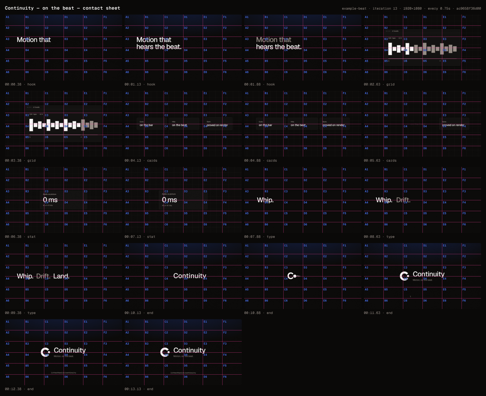

# Continuity — on the beat

> For motion designers on X: Continuity's films now cut, hit and morph on the music — and prove it.

**Format:** 16:9 · 1920×1080 · 30fps · 13.5666s · theme `litt-dark`

| # | Scene | In | Duration | Intent | Transition out |
|---|---|---|---|---|---|
| 1 | `hook` | 00:00.00 | 1.9333s | Stake the claim on the first downbeat: motion that hears the beat. | cut |
| 2 | `grid` | 00:01.93 | 1.9333s | Show the machine listening: the beat grid of this very track, lighting beat by beat. | cut |
| 3 | `cards` | 00:03.87 | 2.4134s | What it does with the beat: cuts, hits, holds — each card whipping in on its kick. | morph |
| 4 | `stat` | 00:05.80 | 1.9333s | The proof, as a number: the render's own audio lands within milliseconds of the picture. | cut |
| 5 | `type` | 00:07.73 | 1.9333s | The feel, in three words: whip, drift, land — each word doing what it says on a beat. | cut |
| 6 | `end` | 00:09.67 | 3.9s | The wordmark becomes the mark on the downbeat; the line lands; hold. | cut |

## Iteration #13 (best)

- Gate: ✅ pass — 0 errors, 0 warnings
- Critique: intent 4 · composition 3 · typography 4 · temporal 4 · craft 3 (mean 3.6)
- Render: `out/example-beat/example-beat-ac9658f36d00.mp4`
- Note: Sync is airtight (6/6 cuts on the bar, 28 moves on beats, 0 near misses, av-sync +0) and whips open on the smear, but both showcase morphs glitch: c3->tile double-exposes copy for one frame (f178) and pops brighter at handoff (f189); word->mark sheds fragments f320-f329 (bitten n, detached dot, 20px 'ntinuity' in the C) then retypes the word it just ate; 4/6 frames centred with three equal cards, unchanged since #3

## History

- #3 vs #13 → **#13** — round-3 critique 3.6 vs 3.2: cuts and moves on frames, no blank cut frames, carrier holds
