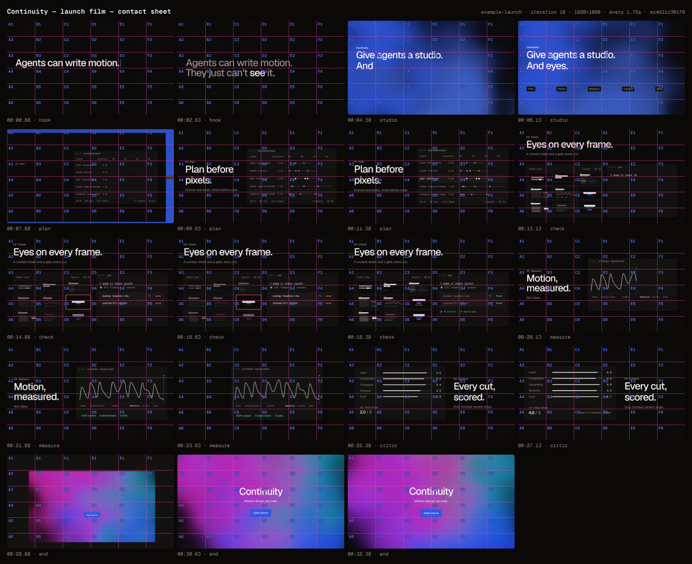

# Continuity — launch film

> For design engineers who have seen too much sloppy AI video: Continuity gives agents a studio process and eyes, so what they make is good enough to ship. Open source.

**Format:** 16:9 · 1920×1080 · 30fps · 32.5s · theme `litt-dark`

| # | Scene | In | Duration | Intent | Transition out |
|---|---|---|---|---|---|
| 1 | `hook` | 00:00.00 | 3.6s | Name the problem in one breath: agents can write motion, but they can't see it. | cut |
| 2 | `studio` | 00:03.60 | 4.4s | The turn: Continuity gives agents a studio process, and eyes. | portal |
| 3 | `plan` | 00:07.10 | 5s | Plan before pixels: the director writes a storyboard of scenes, copy and timed beats before any code. | carry |
| 4 | `check` | 00:12.10 | 7s | Eyes on every frame: the contact sheet shows a defect, the gate names it, the fix turns it green. | carry |
| 5 | `measure` | 00:19.10 | 4.6s | Motion, measured: rhythm, easing and dead air are numbers the agent checks, not vibes. | match |
| 6 | `critic` | 00:23.70 | 5.4s | A critic scores every cut on five axes, and only the best version ships. | portal |
| 7 | `end` | 00:28.30 | 4.2s | Brand, promise, CTA: Continuity. Motion design, as code. Open source. | cut |

## Iteration #18 (best)

- Gate: ✅ pass — 0 errors, 0 warnings
- Critique: intent 4 · composition 4 · typography 5 · temporal 4 · craft 4 (mean 4.2)
- Render: `out/example-launch/example-launch-ac4d11c301f9.mp4`
- Note: B3: translate-only carries, portal via Ships at J6 (flow benchmark)



### Critique

# Critique B3: example-launch (translate-only carries + portal through Ships), independent critic

- Branch claude/kind-wozniak-vfwwac · HEAD 0409e55 · sources hash ac4d11c301f9
- **Iteration: 18** (`ct status`: "#18 ac4d11c301f9 gate ✔ (0w) · draft render ← current sources"; best is #15 = B2)
- Gate (iteration 18 findings.json): **0 errors · 0 warnings · 0 info**. Render QC: one info, `frozen` 1.67s from
  15.00s (check's deliberate red hold, unchanged).
- Draft: out/example-launch/example-launch-ac4d11c301f9-draft.mp4 (32.50s, 975 frames, 30fps). B2's draft
  (example-launch-77e5bb2d4eac-draft.mp4) was on disk, so no worktree render was needed.
- `ct motion` (iterations/018/motion.png): active 68% · **0 dead zones · 0 jolts** · mean energy 0.90 (B2 0.76).
  - J3 and J4 are each a ramp into one spike, then a smooth decay. There is no post-cut second spike.
  - J6 is no longer a one-frame full-height line. It is a ~0.4s double hump (28.6–29.0), as tall as J2's portal.
- Register: calm. Joins:
  - J1 hook→studio: `cut` @3.60
  - J2 studio→plan: `portal via plan` 0.9s, 7.10–8.00
  - J3 plan→check: `carry left 12, layers` @12.10
  - J4 check→measure: `carry left 10, layers` @19.10
  - J5 measure→critic: `match [chart→card]` 0.9s @23.70
  - J6 critic→end: **`portal via ships` 0.8s, 28.30–29.10** (new)
  - The portal is the only accent type. Match and carry count as cuts, and there is no still cut.

```
Scores: intent 4 · composition 4 · typography 5 · temporal 4 · craft 4   (mean 4.2)
litt: ✅ P1 P2 P4 P5 P6 P7 P9 P11 P12 Motion Tells · n/a P3
      (P6/P7 note, unchanged from B2: the chapter cameras scale about the frame centre, so check's label settles at
       x≈70 (t-17.732) and critic's card at x≈72 (t-27.382) instead of 96. Tells note: the end card's aurora field
       (magenta→violet→teal→blue) is the closest the film comes to the purple-blue hero tell.)
energetic: n/a (calm)
```

The integer scale hides the gain. Every axis is the same integer as B2, but B3 is a high 4 on Temporal and Craft,
and it wins the pairwise comparison clearly (below).

## Axis evidence

- **Intent 4.** The settled frames are identical to B2's (compare packs, both orders). The only differences are data
  strings: "975 frames / 32.5s" vs "987 / 32.9s".
  - J6 now says "the verdict opens onto the call to action". The colour of the end card arrives *inside* the Ships
    tag.
  - Lost against B2: the pill no longer *becomes* the button (fill and corner turning). The button is simply
    contained in the window from its first frame, so "Ships → Open source" is now containment, not transformation.
    That is a small semantic step down, outweighed by the eye actually being there.
  - Still docked for two things carried over from B2: the rail is never revisited after the portal, and the
    see → "eyes." rhyme at J1 is carried by timing only.
- **Composition 4.** Unchanged from B2. All seven stills were read at full size (iterations/018/stills).
  - Plan and measure keep the split. Check is stacked and dense, at about 75% of the safe area. Critic is mirrored,
    with the card at x 72–1123 and the lockup at x 1224. The end card is centred, the one centred frame.
  - Docked for the camera drift (x≈70 instead of 96) and check's density.
- **Typography 5.** Unchanged. Geist 400/500/600 by role, two inks, one display line per scene, sentence-case
  labels, mono only for data, tabular figures, and status as words.
- **Temporal 4 (high).** The carry is now a pure translation, and every carry and match join is speed-continuous on
  screen. Measured on full-res frames by column-run edge detection (the script lives in the scratch dir;
  per-frame px):
  - **J3 out:** the board's left edge goes −6, −15, −22, −30, −38, and the right edge matches it exactly (−38), so
    there is no scale change. Accelerating t² extrapolates to about −46 at the cut.
  - **J3 in:** the sheet goes **−48, −42, −37, −31, −28, −23, −17, −12, −7, −5, −3, −1**. The terminal goes
    **−47, −42, −37, −33, −29, −23, −18, −13, −9, −5, −5, −2**. The two surfaces now move together, against B2's
    −26/−22/−21 vs −55/−48/−42. The sheet holds 895 px wide from the cut to rest, against B2's shrink from 1025 to
    892. The pump is gone.
  - **J4 out:** the terminal's left and right edges both go −4, −12, −19, −26, −34. In B2 the right edge was −17
    against −35 on the left, which was the "breath".
  - **J4 in:** the chart's left edge goes −42, −38, −34, −29, −23, −16, −12, −6. The extrapolated −41 at the cut
    lands on −42, so there is no surge.
  - **J5 match:** unchanged from B2, and still the reference. Into the cut: −28, −30, −33, −31. Out of it: −30, −28,
    −27, −26, −26, −24 … The speed only falls after the cut.

  Docked for three things:
  - (a) **J6 compresses a ~19× zoom into 0.8s.** The via goes 97 → 1919 px wide over 28.367–29.100. The per-frame
    growth peaks at **+41%/frame** at 28.70–28.77 (443 → 623 → 831 px), and it is the film's tallest motion spike.
    §9 asks about 1.4s for a 15× macro. J2 (0.9s, about 17×) has the same issue to a lesser degree.
  - (b) **J5 still has a 0.9s copy-free transit.** Measure's lockup has gone by 23.54, and critic's label arrives at
    24.45.
  - (c) **J3's terminal lands idle.** It shows only "$" until 12.60 (typeOn at b2 = 0.5). Check's copy arrives only
    after the carry has landed: the label at 12.25 and the headline mask at 12.40–12.75. So the incoming wave is
    surfaces only, while J4's incoming copy rides the carry on frame 0.
- **Craft 4 (high).** Material is static, cards are flat, there is one accent type, and no join is still. Join tally:
  element 2 (J2 and J6 portals), place+speed 1 (J5), layered direction 2 (J3, J4), action 1 (J1).
  - Two of B2's three craft defects are fixed:
    - the carry zoom pump is gone (pure translation);
    - J6's colour change now has a carrier big enough for it, because the window *is* the change.
  - B2's third item ("the portal flattens the cobalt field") I don't count. Zooming 17× into a soft field should
    flatten it.
  - Docked for:
    - (a) **A new 2-frame ghost at J6.** At t28.333 and t28.367 a translucent "Ships" sits over the aurora thumbnail
      (J6tag-crop.png). `ships-word` fades out over 4.60–4.70 while the portal's window fades in over 0.24s from
      4.60, so the two crossfade. This is the exact defect fixed at J2 in B2, by stepping `plan-word` out 0.1s
      *before* the portal.
    - (b) J1 still lands on one empty frame of cobalt field (t3.600) before the headline mask breaks at 3.633.

## Per-join FLOW notes (frames in frames-B3-critic/)

**J1 hook→studio, cut @3.60. Unchanged.** At 3.567 "see" is alone in fg. At 3.600 there is one frame of empty
field, and at 3.633 the label is in and the headline mask is breaking. **Carries: an action (weakly).** It is now the
weakest join in the film.

**J2 studio→plan, portal via plan, 7.10–8.00. Unchanged from B2.**
- 7.000: "Plan" is still in the tile. 7.100: the tile is clean.
- 7.2–7.4: the tile grows with the thumbnail inside it. 7.5: "Check" and the headline fly past.
- 7.6–7.9: plan's first frame fills the frame. 8.0: plan.
- The zoom is fast and off-axis, with the via at the bottom left. **Carries: an element.**

**J3 plan→check, layered carry left @12.10. Fixed (the B2 problem).**
- 11.9–12.067: copy-led out. The headline leaves ahead of the board.
- From the cut, the sheet and the terminal travel as one row at one speed (−48/−47 → rest by 12.50), with no size
  change. On the cut frame both surfaces are full (the sheet's nine frames are visible).
- What remains is the **mass jump**. The eye leaves the board at the upper right (centre ≈1322,547) and lands on a
  row across the lower half (y 405–1005) whose right member is an idle "$" terminal, with nothing in the top 400 px
  until 12.25. It reads as a pan to a new shelf, not a handoff of the thing you were looking at.
- **Carries: a direction, with a layered wave out; surfaces only in.**

**J4 check→measure, layered carry left @19.10. Fixed (the B2 surge).**
- 18.8–18.9: check's lockup exits first. 18.9–19.067: the sheet and terminal translate as one plane (−34 on both
  edges).
- 19.100: "Motion, measured." is already on screen, motion-blurred, with the chart trailing at −42, −38, −34. One
  speed through the cut.
- The cleanest carry in the film. **Carries: a direction, with copy leading in.**

**J5 measure→critic, match chart→card 0.9s @23.70. Unchanged.** One panel, one speed, only slowing, at the same y
and size; it settles at x≈96 by about 24.6. The remaining cost is the 0.9s copy-free transit. **Carries: a place
and a speed.**

**J6 critic→end, portal via ships 0.8s, 28.30–29.10. Much better than B2's match.**
- 27.28–28.30: Ships has settled. A 1.0s settled hold (B2's was 2.0s).
- 28.333–28.367: the tag's green word gives way to a magenta/violet thumbnail of the end card. It is the only
  saturated thing in the frame, so the eye goes to it. But for 2 frames the word ghosts over it (fix 1).
- 28.4–28.6: the window grows slowly (97 → 189 px). The card and copy start to fly past.
- 28.7–28.9: it grows fast (443 → 1045 → 1561 px). Giant "of 3 versions" and "Every … scored" pass the edges, and
  the window's centre drifts from (1024,763) to (960,540).
- The "Open source" button is inside the window throughout, at (1011,751) → (990,717) → (960,668). So the eye's
  point barely moves while the colour expands around it. **This is the handoff B2 lacked.**
- 29.1: full frame. 29.13: the wordmark settles. 29.7: the tagline.
- Costs: the 2-frame ghost, and the 19× zoom in 0.8s (peak +41%/frame), which reads a touch lunging next to the calm
  carries.
- **Carries: an element, and in practice too.**

## Top fixes (max 5, highest impact first)

1. **[craft] critic.ships-word @28.30–28.37: a 2-frame "Ships" ghost over the portal window.**
   - In `scenes/critic.tsx`, change `m.exit("ships-word", "fadeOut", { at: \`end-${PORTAL_S}\`, duration: "instant" })`
     to `at: \`end-${PORTAL_S + 0.1}\``.
   - This is the same pattern as studio's `plan-word` (3.40 for a 3.50 portal). The tag is then clean and green for
     3 frames before the window opens.
2. **[temporal] critic→end portal: about 19× in 0.8s, peak +41%/frame.**
   - In `storyboard.json`, make critic's `transition.duration` 0.8 → 1.0, and critic's `duration` 5.4 → 5.6 so the
     settled hold before the portal stays at about 1.0s.
   - Move end `b2` 0.85 → 1.05 and `b3` 1.4 → 1.6. `PORTAL_S` already follows the storyboard.
   - Optionally do the same for J2 (0.9 → 1.0).
3. **[temporal/flow] check @12.10–12.75: the idle terminal and copy that misses the carry.**
   - Move `b2` 0.5 → 0.1 so `cmd-l0` is typing as the row lands.
   - Move `b1` 0.3 → 0.1 (and the label to `b1-0.1`) so the label and headline enter *during* the carry and ride its
     layer shift, the way measure's copy does at J4.
   - Optionally lift check's surfaces by 96px for the first 0.4s, to soften the upper-right → lower-row mass jump.
4. **[temporal] critic, 23.54–24.45: 0.9s with no copy.**
   - Move critic `b1` 0.9 → 0.6 (the label at `b1-0.15`, the headline mask at `b1`). The copy then arrives as the
     card's speed drops below about 15 px/frame (≈24.15).
   - Or hold measure's lockup longer (`b4` 4.1 → 4.3).
   - Keep the match's 0.9s.
5. **[composition] chapter cameras (plan, check, measure, critic): the edges drift to x≈70.**
   - Add `{ origin: { x: 96, y: 540 } }` to the copy-anchored cameras, and `x: 1824` on critic. Or cap those pushes
     at 1.015.

## Keep (don't touch)

- **The translate-only carry engine.** J3's two surfaces at −48/−47 and J4's one plane at −34 → −42, with no size
  change. It is the single biggest fix to the "rigid" feel since B1.
- **J6's portal through Ships.** The colour arrives inside the verdict, and the CTA sits under the eye from the
  first open frame. Fix its timing (fixes 1–2), not its idea.
- **J5's chart→card match.** One object at one speed, and the film's best join.
- **J3's copy-led exit, J4's copy-led entrance.** The two carries have different envelopes, so the chapters are not
  a carousel.
- **J2's clean Plan tile portal**, and the 1.0s settled hold before J6, which is better paced than B2's 2.0s.

## Pairwise: B2 (iteration 15) vs B3 (iteration 18)

Method:
- Ran `npx ct compare example-launch 15 18` and read
  projects/example-launch/.continuity/iterations/018/compare-15-18/pack-ab.png and pack-ba.png in both orders.
- Measured B2's J3/J4 from its draft with the same edge script, and compared the J6 frames (frames-B2-critic/J6.png
  vs frames-B3-critic/J6a/J6b).

Per axis:
- **Settled packs, both orders:** identical apart from data strings. Intent, composition and typography tie. Intent
  edges to B3 on J6's meaning: the colour arrives through the verdict.
- **Temporal: B3.**
  - J3: one speed for both surfaces (B2 split them 1:2.1), and no 15% shrink in 0.3s.
  - J4: no breath or surge (one plane at −34 → −42, against B2's −35/−17 edges → −43).
  - J6: a 0.8s expanding window instead of a one-frame full-frame flash.
  - J5 is identical. J6's zoom rate is the one new temporal cost.
- **Craft: B3.**
  - Two of B2's three named defects are fixed: the zoom pump, and a J6 carrier too small for its change.
  - One new defect: the 2-frame ghost.
- **Both orders agree. Winner: B3 (iteration 18).** Gate errors are 0 vs 0, so B3 may replace the best.
  Reason: "B3: carries are pure translations — J3 surfaces move together (−48/−47), J4 has no surge; J6 colour
  arrives through the Ships tag instead of a full-frame flash."

**Joins where B3 is worse than B2:** none overall. Locally, J6 trades B2's exact pill → button transformation for
containment, adds a 2-frame word ghost, and has a faster zoom peak. The flash it removes outweighs all three.
J1, J2 and J5 are identical.

**Top 3 remaining flow problems in B3:**
1. J3's landing: the eye jumps from the upper-right board to a lower row whose terminal is an idle "$", and check's
   copy enters only after the carry. The incoming wave has no lead.
2. J6 (and J2) portal pacing: about 19× in 0.8s, peaking at +41%/frame, plus the 2-frame "Ships" ghost. The
   portals read faster and more effortful than the calm carries around them.
3. J1 is a hard cut through one empty field frame that carries only timing, and J5 has a 0.9s copy-free transit.
   Together they are the two places where the film still "waits" between ideas.


## Frames read

- Contact sheet (`--anchors`): projects/example-launch/.continuity/iterations/018/sheet.png
- Motion chart: projects/example-launch/.continuity/iterations/018/motion.png
- Settled stills (iterations/018/stills/), all at full size: t-1.792, t-6.700, t-10.453, t-17.732, t-21.612,
  t-27.382, t-30.153
- Compare packs: iterations/018/compare-15-18/pack-{ab,ba}.png
- Join frames (frame-accurate, frame n at n/30 s), extracted from the draft into a working folder:

  | Montage | Frames |
  |---|---|
  | J1.png | t3.300 3.533 3.567 3.600 3.633 3.667 3.900 4.600 |
  | J2a.png | t6.8–7.4 |
  | J2b.png | t7.5–8.3 |
  | J3.png | t11.800 → 12.600, with every frame from 12.000 to 12.200 |
  | J4.png | t18.800 → 19.400, with every frame from 19.000 to 19.200 |
  | J5.png, J5b.png | t23.0 → 25.0, with every frame from 23.6 to 23.8 |
  | J6a.png | t27.9 → 28.4, with every frame from 28.2 to 28.4 |
  | J6b.png | t28.5 → 30.0, with every frame from 29.1 to 29.133 |
  | J6tag-crop.png | the tag at t28.267, 28.300, 28.333, 28.367 and 28.400, at 3× |

  Individual frames are t<seconds>.png. Edge measurements came from every frame of 11.6–12.8, 18.6–19.8 and 23.0–24.5
  (B3) and 11.9–12.5, 18.9–19.5 (B2), extracted to the scratch dir.


## History

- #8 vs #12 → **#12** — B1: joins carry a direction and an element (portal through Plan tile, entrance on the J1 cut, speed-matched carries) vs four identical slides; rest frames unchanged
- #13 vs #15 → **#15** — B2: distinct layered carries landing with content; J5 one object at one speed through the cut; portal ghost gone. Only J6 marginally worse (hard cut black→aurora, carrier too small)
- #15 vs #18 → **#18** — B3: carries translate only — J3 surfaces move together (−48/−47 vs B2 −26/−55), no J4 surge; J6 end-card colour arrives through the Ships tag instead of a full-frame flash
