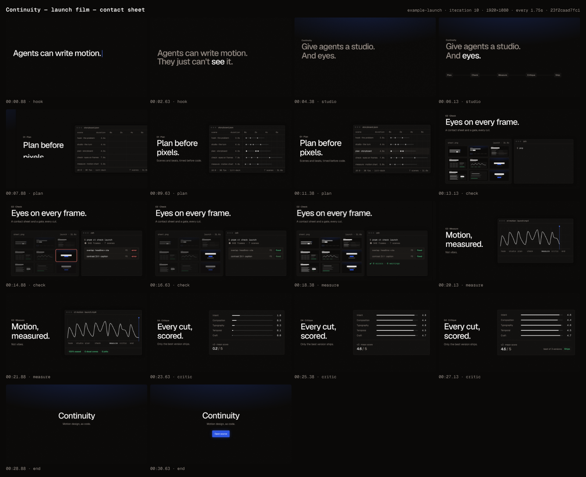

# Continuity — launch film

> For design engineers who have seen too much sloppy AI video: Continuity gives agents a studio process and eyes, so what they make is good enough to ship. Open source.

**Format:** 16:9 · 1920×1080 · 30fps · 31.6s · theme `litt-dark`

| # | Scene | In | Duration | Intent | Transition out |
|---|---|---|---|---|---|
| 1 | `hook` | 00:00.00 | 3.6s | Name the problem in one breath: agents can write motion, but they can't see it. | cut |
| 2 | `studio` | 00:03.60 | 4.4s | The turn: Continuity gives agents a studio process, and eyes. | push |
| 3 | `plan` | 00:07.50 | 4.8s | Plan before pixels: the director writes a storyboard of scenes, copy and timed beats before any code. | push |
| 4 | `check` | 00:11.80 | 7s | Eyes on every frame: the contact sheet shows a defect, the gate names it, the fix turns it green. | push |
| 5 | `measure` | 00:18.30 | 5s | Motion, measured: rhythm, easing and dead air are numbers the agent checks, not vibes. | push |
| 6 | `critic` | 00:22.80 | 5.1s | A critic scores every cut on five axes, and only the best version ships. | dip |
| 7 | `end` | 00:27.40 | 4.2s | Brand, promise, CTA: Continuity. Motion design, as code. Open source. | cut |

## Iteration #10

- Gate: ✅ pass — 0 errors, 0 warnings
- Render: `out/example-launch/example-launch-23f2caad7fc1.mp4`

