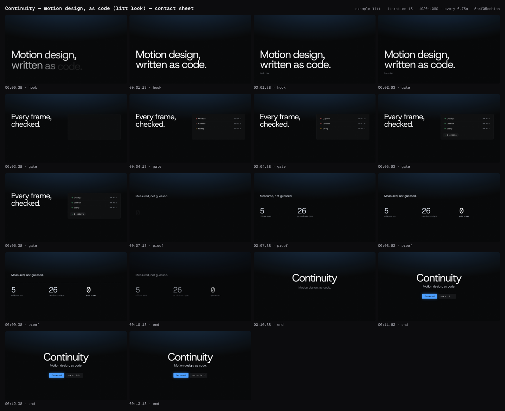
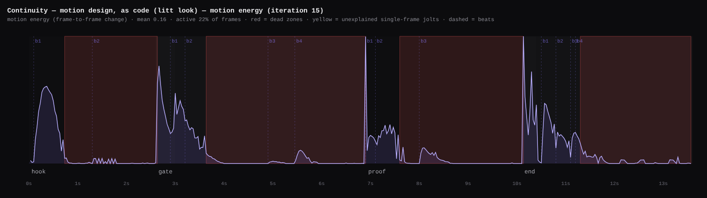

# Continuity — motion design, as code (litt look)

> For design engineers and motion designers meeting the litt look for the first time: motion design written as code, every frame of it checked (precise, quiet, provable), ending on one action, Get started.

**Format:** 16:9 · 1920×1080 · 30fps · 13.6s · theme `litt`

| # | Scene | In | Duration | Intent | Transition out |
|---|---|---|---|---|---|
| 1 | `hook` | 00:00.00 | 3s | Stake the promise in one calm line: motion design is written as code. | crossfade |
| 2 | `gate` | 00:02.60 | 4.3s | Prove the claim: a gate checks every frame, and a findings list resolves to 0 errors. | cut |
| 3 | `proof` | 00:06.90 | 3.5s | Proof in numbers: three stable facts in mono; the last one, 0, is the point. | dip |
| 4 | `end` | 00:10.10 | 3.5s | Name it and ask for one action: Continuity, Motion design, as code., Get started beside npx ct init. | cut |

## Iteration #15 (best)

- Gate: ✅ pass — 0 errors, 0 warnings
- Critique: intent 5 · composition 5 · typography 5 · temporal 5 · craft 5 (mean 5)
- Render: `out/example-litt/example-litt-5c4f05ceb1ea.mp4`
- Note: Dip shortened 0.4 to 0.3 (trough 10.25, flat black for 1-2 frames) to clear render:black-frames; end starts 10.1, total 13.6s; settled frames and every other beat identical to iter 11. Dip now reads as a quick blink rather than a breath (halves are exactly 0.15s) but is inside its craft range; proof hold before the dip is 1.65s.

## History

- #9 vs #10 → **#10** — Both pack orders agree. Gate block now centred (y312-716) and match-cuts to proof; proof 5/30 muted so the 0 is the settled focal point; CTA button no longer pops alone (chip follows at 1.1); verdict lands 0.21s after the dot flip; hook filename types visibly; dead-air info cleared. No regressions, same gate errors (0).
- #10 vs #11 → **#11** — Both pack orders agree; only the proof middle stat changed. 26 px minimum type is a gate-enforced rule (probe minWarn 26), so 5 / 26 / 0 now read as three things the gate measures; 30 fps was a render spec. Layout, timing, tone hierarchy and every other scene identical; same gate result (0 errors, 0 warnings, 0 info).
- #11 vs #13 → **#13** — Both pack orders show identical settled frames (only the dip timing changed, which the sampled frames cannot show). Stills at 10.15/10.25/10.45/10.6 confirm a clean 0.3s dip with a 1-2 frame black trough and the end card starting right after; #13 clears the render:black-frames QC finding that #11 carried, with gate and --deep at 0/0/0.
- #13 vs #15 → **#15** — Same sources (hash 5c4f05ceb1ea): #15 is #13 re-gated (0/0/0) and carries the critic's scores (5/5/5/5/5), the stills, the final render and the motion chart; recorded so the best iteration holds all the evidence.

## Known gaps (not blocking)
- **Banding in the `lit` gradient.** At about 0.6 Mbps 8-bit H.264 the dark top light steps
  roughly one level per 30px. It is invisible at 1x on most screens and shows under a 12×
  contrast stretch. `--quality delivery` encodes identically, and a dithering grain
  (normal blend at 4%) did not survive the encoder, doubled the file and was reverted.
  A 10-bit or higher-bitrate encode is the real fix.
- **`ct motion` reads four "dead zones"** (0.73–2.63, 3.63–6.90, 7.60–10.13, and the end hold).
  The energy metric is the mean frame difference over a 320px-wide frame. The status dots
  flipping, the 250×68 verdict pop, the counters and the caret all sit under its 0.12
  threshold, so the 3.63–6.90 zone contains both the green flip and the verdict. The
  timeline-level `dead-air` lint, which knows every tween, reports none, and the critic
  scored temporal 5 from the timeline. Lit precision holds still on purpose; ambient
  backdrop or camera life would break the "material never moves" rule.
- **The dip is 0.3s, not the recipe's 0.4s.** On a near-black canvas a 0.4s dip holds the
  black trough past render QC's 0.25s `black-frames` window. Any litt film using the
  recipe's dip will hit this.
- **t crossbars touch the next glyph at 168px** ("Continuity", "written"). This is how a tight
  Helvetica Now Display-style setting looks; kern a pair before loosening a line.

## How this was made
`ct new --theme litt` → director agent (storyboard, treatment) → four scene-builder agents in
parallel, one per scene, each with an isolated gate → full gate 0/0 → critic: iteration 9
scored 4.4 → round 1 (the CTA chip follows the button, gate block centred to match-cut into
proof, the proof 0 the one fg figure, the verdict waits for the last dot, the file name
types visibly) → iteration 10 scored 4.8 → round 2 ("30 fps" replaced by the 26px
legibility floor the gate enforces) → iteration 11 scored 5.0 → dip 0.4 → 0.3 for render QC
→ iteration 15 (same sources as 13) 5.0, best. Gate and `--deep` 0/0/0; render QC clean;
motion 0 jolts (after fixing `ct motion`'s exponent parsing). Verified under `litt-light`
too: gate 0/0/0 on a gitignored copy with the theme flipped. All agents ran on Sonnet.

