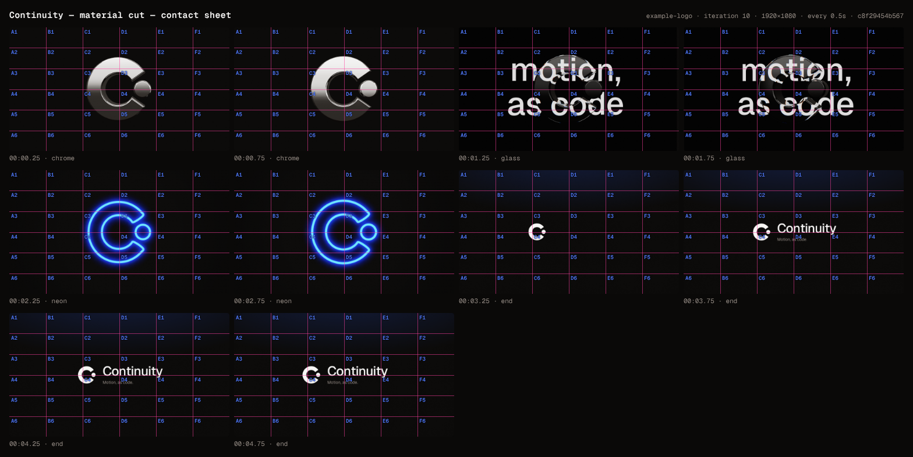

# Continuity — material cut

> For designers on X: one mark, three materials, every cut on the beat — made as code.

**Format:** 16:9 · 1920×1080 · 30fps · 6s · theme `litt-dark`

| # | Scene | In | Duration | Intent | Transition out |
|---|---|---|---|---|---|
| 1 | `chrome` | 00:00.00 | 1s | Chrome: the mark whips round to face us and drifts — the first hit. | cut |
| 2 | `glass` | 00:01.00 | 1s | Glass: the same mark bends the grid behind it. | cut |
| 3 | `neon` | 00:02.00 | 1s | Neon: the mark as light, in the accent. | cut |
| 4 | `end` | 00:03.00 | 3s | The lockup: the neon mark cuts to the flat mark at the same size and place, holds a beat, then flies into the lockup; the wordmark types, the line wipes on the bar. | cut |

## Iteration #10 (best)

- Gate: ✅ pass — 0 errors, 0 warnings
- Critique: intent 3 · composition 3 · typography 4 · temporal 3 · craft 2 (mean 3)
- Note: Beat-cut formula works; whips never read (85% in 1.5f, glass/neon start 72% through, cuts 1f late); end card breaks the match cut and misses the 4.0 downbeat; glass shot broken (exposed plane, 3.8 black, sliced bevels)

### Critique

Scores: intent 3 · composition 3 · typography 4 · temporal 3 · craft 2   (mean 3.0)
litt: ✅ P1 P2 P3 P5 P6 P9 P11 tells · n/a P4 P12 · ❌ P7 (glass.type, 340px over two lines, out-shouts glass.mark: two ideas in one shot; centring all four scenes is right for a logo film's match cut)
energetic: ✅ E1 E2 E3 E5 E7 · ❌ E4 (neon→end has no match: 576px centred → 150px at x 679) E6 (glass black 3.8 vs canvas 12.8; grain/vignette on neon only) E9 (the ending doesn't answer the opening; 10 beats don't loop on a bar) · n/a E8

Top fixes:
1. [temporal] chrome.mark / glass.mark / neon.mark @00:00.00, 01.00, 02.00: the whip doesn't read. 85% in 1.5 frames, no GL motion blur: chrome jumps −75°→−20.4° between frames 0 and 1. glass and neon start at 1.0023/2.0023, so their first frame is already 72.7% through and the whip is never rendered. Every cut lands on frames 31/61/91, one frame after its beat.
   → engine: round beat-derived scene starts to the frame grid (stopgap: chrome/glass/neon "duration": 1). ease { type: "whip", snap: 0.15, share: 0.85 } (chrome per frame −75, −44.8, −27.4, −18.2, −13.1). glass rotateY [48,−14]; neon rotateY [40,0] rotateX [−12,0]; chrome lands at rotateY −14, rotateX 6 so the extrusion catches the top light.
2. [intent/temporal] end.mark @00:03.00: the payoff breaks the match cut (neon 576px at 960,540 → flat 150px at 679,540), and the 4.0s bar downbeat (low hit 0.79) lands on a frame that has been still since 3.8s.
   → hold end.mark at x 281 / scale 3.84 for beats 0–1, then m.tween("mark",{x:[281,0],scale:[3.84,1]},{at:"move"(beat 1),ease:"steep",duration:"snap"}). word types at beat 1.5; line wipes at beat 2 = 4.0s. end "duration": {"beats": 6} → 6.0s = 3 bars (line held 2.0s; the X loop seams on a bar).
3. [craft/composition] glass.type + glass.mark @00:01.03–02.00: the backdrop plane edge is exposed (25px right at 1.03–1.07s, 10px left at 1.95–2.0s). Its black is 3.8 vs 12.8 elsewhere. Refraction slices the type into comb/sawtooth bands with RGB fringes along every bevel. The type dominates the mark.
   → plane 2400×1350 → 2880×1620. Type 340 → 220px, copy in storyboard glass.text.type = "Motion, as code.". Bevel 18 → 8. engine: plane toneMapped:false; extrude bevelSegments 5→12 and curveSegments 24→64 (also chrome's dashed highlights); dispersion 0.08→0.03; 2× supersampling.
Also: glass.shot-camera inOut→out (the only mid-shot swell, at 1.5s). Add grain 0.035 + vignette 0.35 to chrome and glass. Frame 0 (the X poster) is an edge-on slab: −60° still whips and reads as the C.

Keep: the formula (same mark at ~580px, same centre, a hard cut every 2 beats); neon's cobalt bloom handing its colour to the end card's top light; the optical lockup (mark spans cap top 466 → tagline baseline 613, 500/400, fg/grey); word typed on the half-beat, line wiped on the beat; static grain; all cuts.

## History

- #10 vs #21 → **#21** — round-3 critique 3.4 vs 3.0: cuts frame-exact, chrome reads, glass no longer broken, match cut
