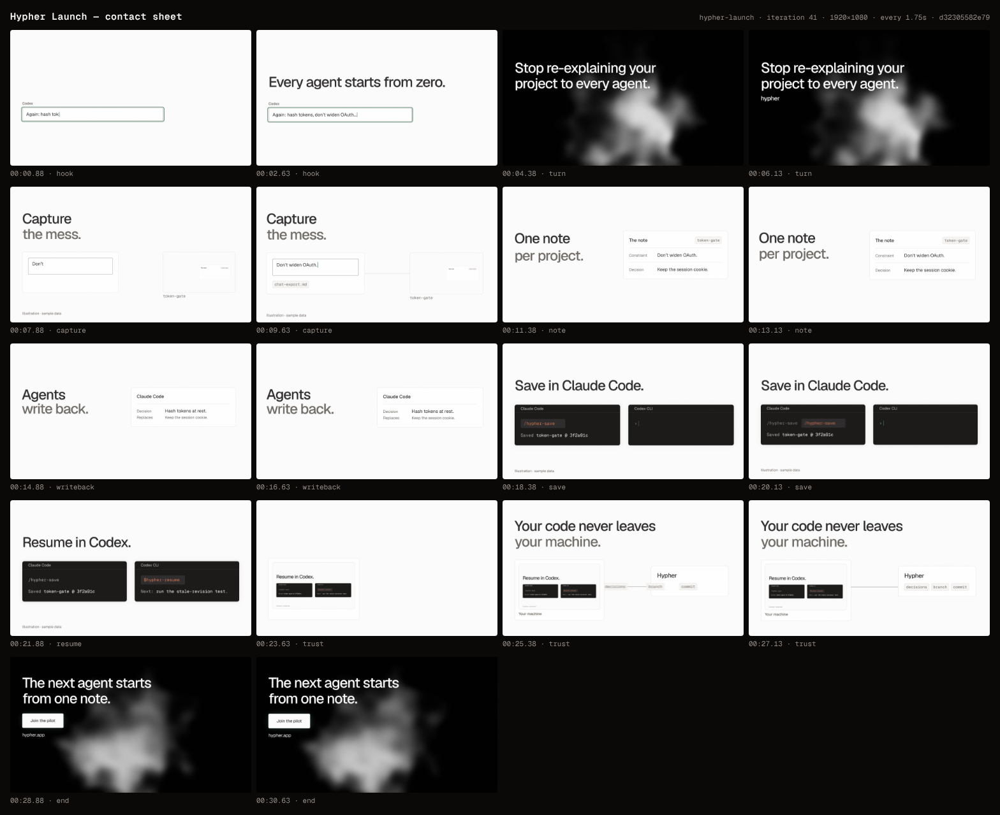

# Hypher Launch

> For builders who switch between Claude Code and Codex on one repo: stop re-explaining your project. The next agent starts from one note. Join the pilot at hypher.app.

**Format:** 16:9 · 1920×1080 · 30fps · 31s · theme `litt-light`

| # | Scene | In | Duration | Intent | Transition out |
|---|---|---|---|---|---|
| 1 | `hook` | 00:00.00 | 3.4s | The pain: you are typing your project's context into yet another agent, again. | cut |
| 2 | `turn` | 00:03.40 | 3.6s | The turn: the must-say promise on the site's black smoke, signed by the name. | carry |
| 3 | `capture` | 00:07.00 | 3.8s | Step one: capture the project as it is, and it goes into the note. | portal |
| 4 | `note` | 00:09.90 | 3.6s | Step two: Hypher keeps one bounded note per project; the capture is now in it. | carry |
| 5 | `writeback` | 00:13.50 | 3.4s | Step three: when an agent stops, it writes back why a decision changed. | carry |
| 6 | `save` | 00:16.90 | 3.3s | The handoff, part one: one explicit command saves it in Claude Code. | match |
| 7 | `resume` | 00:20.20 | 3.6s | The handoff, part two: Codex resumes from the note and starts on the next action. | portal |
| 8 | `trust` | 00:22.80 | 4.4s | Trust: the session was on your machine all along; only decisions, branch and commit travel, never code. | cut |
| 9 | `end` | 00:27.20 | 3.8s | Payoff and CTA: the next agent starts from one note. Join the pilot. | cut |

## Iteration #41 (best)

- Gate: ❌ fail — 1 errors, 0 warnings
- Critique: intent 5 · composition 4 · typography 4 · temporal 4 · craft 4 (mean 4.2)
- Render: `out/hypher-launch/hypher-launch-d32305582e79-draft.mp4` (draft)
- Note: round 3: title-safe right column, readable chips, end on the cut, two-ink headlines

### Known issues (1 errors, 0 warnings)

- **motion_appears_late** save.save-echo @00:20.25 — never reaches visible opacity but should be visible by 20.25s (check its entrance reveal fires under seek)



### Critique

# Critique r4: hypher-launch, iteration 41 (d32305582e79, round 3) vs iteration 39 (212355b8a965, round 2)

Evidence:
- Gate (iteration 41): 0 errors, 0 warnings. 16 infos: 13 content_overlap and 3 text_occluded, all during the portals. The trust→end `dead-cut` info from #39 is gone.
- Draft: `out/hypher-launch/hypher-launch-d32305582e79-draft.mp4`. Render QC clean, 31.00 s.
- `ct motion`: active 67%, 0 dead zones, 0 jolts (`iterations/041/motion.png`). Contact sheet: `iterations/041/sheet.png`.
- `ct compare 39 41`: `iterations/041/compare-39-41/pack-ab.png` and `pack-ba.png`.
- Frames are in `.continuity/critic-r4/`, with the same frame numbers for both drafts:
  - `cur/` (#41) and `r2/` (#39): f270 and f296 (capture settled, end of push); f390 and f404 (note); f470, f489 and f506 (writeback); f744–f790 (trust chips); f807–f840 (trust→end).
  - `strip-chips-{cur,r2}.png`: the chip lane, every 2 frames from f744 to f790.
  - `strip-trust-end-{cur,r2}.png`: from f807 to f840.
  - `strip-wb-save-{cur,r2}.png`: from f503 to f510, with a red rule at title-safe x 96.
  - `cur/join`, `r2/join`: f394–416 and f496–518.

All positions below are measured on the decoded drafts: the extent of non-background pixels, ±2 px.

```
Scores: intent 5 · composition 4 · typography 4 · temporal 4 · craft 4   (mean 4.2)
litt: ✅ P1 P2 P3 P4 P5 P6 P7 P9 P11 tells · P12 n/a · motion ✅ (one expressive per scene, bounce ≤ 0.12, push ≤ 2–3%)
energetic: n/a (calm throughout)
```
The mean is unchanged, but every axis is a firmer 4 than in #39. All four round-3 changes landed as specified. The one new defect is small (fix 1).

## Verification of the round-3 changes

| Change | Measured (#39 → #41) | Verdict |
|---|---|---|
| Right column inside title-safe | Rightmost pixel: capture f270 1834 → **1803**, f296 1840 → **1808**; note f390 1855 → **1806**; writeback f470 1859 → **1802**, f489 1870 → **1806**, f506 1875 → **1808**. | Fixed. Every frame is ≤ 1808 (title-safe 1824). |
| Trust chips staggered 0.12 s, ease `out` | #39: three equal smears that move as a block (f762–774) and become legible only from ~f780. #41: commit leaves the clip at f746, branch at f752, decisions at f758. The gaps open to ~240 px. Legible in the lane: commit by f762, branch by f768, decisions by f772. They land in order f779 → f786. The fastest part of each trip happens behind the panel clip. Settled 1.06 s before the cut. | Fixed. "Three things leave" now reads as three things. |
| End statement on the cut | #39: f816–f825 is bare smoke, with first ink at ~f826. #41: f816–f818 is smoke, first ink at **f819** (+3 f), both lines readable by f825. The slot is identical: trust's headline is at top 164 / left 97, end's at top 165 / left 98. | Fixed. It reads as a swap in place (grey-on-white becomes white-on-black on the same line). |
| Two-ink headlines (solid scenes) | "Capture / the mess.", "One note / per project.", "Agents / write back.", "Your code never leaves / your machine.": the second line is fg-muted, legible, and matches the site. The smoke scenes keep one ink. | Done. It is the brand's most recognisable type device, now on screen. |

## Axis evidence

**Intent 5**
- Unchanged and still earned: the film lands in 0.9 s, the writeback change happens on screen, and the hook "from zero" pays off on the end card "from one note".
- The two-ink pairs now reinforce the reading order (the verb, then what it acts on).

**Composition 4**
- Right edge fixed (above).
- New: the push from the frame centre walks the **left** copy column out of title-safe. The headline's left edge is 96–101 in #39 and **84 → 80** at note f390 → f404 and writeback f470 → f506 in #41. It stays inside action-safe (67).
- Unchanged drags:
  - The capture tile at rest is still 576×324 of white with a 252×116 card sliver in its right half (f270).
  - The writeback card's right half is empty (its text ends at x 1576 and the card at 1802).

**Typography 4**
- The two-ink deduction from r3 is closed.
- The remaining deduction is the turn wordmark. "hypher" is ~40 px, 32 px under a 112 px statement (f190), so it still reads as a caption, not a signature. The brief's own assumption says "Geist 500 at the title step".

**Temporal 4**
- The chips and the end swap are fixed (above). Every other join is unchanged, frame for frame:
  - note→writeback: the incoming headline runs 408·343·286·237…99 in both drafts.
  - writeback→save: 441·409·382…291 in both.
- Still stiff:
  - The in-scene vocabulary is one envelope (a maskUp headline, a rise or two, the push).
  - note holds 2.3 s on the push alone.
  - turn holds 2.6 s on the field after the wordmark.
- New, small: the copy rail jumps across writeback→save (fix 1).

**Craft 4**
- One transition language: cuts, carries and a match, plus `portal` in and out as the accent. Both portals are exact, and the trust→end still cut is now real punctuation, not a gap.
- Known and accepted, not re-scored: the Codex pane's glow reaches ~1860 px during save's 1.02→1 pull-out, and the smoke is soft Gaussian cotton, not the site's ridged silk with grain (shader work).
- Hygiene in `scenes/end.tsx`:
  - The motion uses raw `at: 0.05 / 0.85 / 0.95`, and its comment says the storyboard beats "are stale — the director moves them".
  - But `storyboard.json` already has b1 0.05 and cta 0.85.
  - So the code and the storyboard can drift apart again.

## Regressions

1. **[composition] [flow] The writeback → save copy rail steps sideways.**
   - writeback's headline leaves the cut at left x **82** (f506), and save's headline arrives at **96–103** (f507–f509).
   - That is a ~17 px lateral hop in one frame, in the middle of a vertical carry (`strip-wb-save-cur.png`). In #39 it was 99 → 103.
   - Cause: the push origin moved from the headline's left edge to the frame centre. motion-craft §9 warns about this: "the text drifts and every hard cut snaps it back".
   - It is subtle at 30 px/f of vertical travel, but the left rail was the film's steadiest line.
2. **[composition]** The same drift puts the note and writeback headlines 12–18 px outside title-safe on the left (84 → 78). That is smaller than #39's 51 px overrun on the right, so this is a net gain, not a loss.

No other regressions: the joins, the portals and the match are byte-for-byte the same motion.

## Pairwise: #39 (round 2) vs #41 (round 3)

- Pack A|B (39|41): **#41**. Pack B|A (41|39): **#41**. Consistent in both orders.
- Typography: #41 (the site's two-ink headline on all four solid scenes).
- Temporal: #41 (the chips are legible in flight, and the end statement arrives on the cut).
- Composition: #41, narrowly. Right edge ≤ 1808 vs 1875; the left drift of ≤ 18 px is the smaller breach.
- Craft: #41 (the dead-cut gap is gone, and the chips no longer smear).
- Intent: tie.
- **Winner: 41.** Gate errors are equal (0 and 0). #41 should replace #39 as best.

## Top fixes (max 5, highest impact first)

1. **[composition] [flow] [scene:capture] [scene:note] [scene:writeback] Hold the copy rail still and keep both edges in safe.**
   - → Anchor all three pushes back on the headline's left edge (origin x = 96, keeping the headline's top line as y), at 2%.
   - Pull `RIGHT_EDGE` in by 16: `CARD.width` 832 → 816, and the capture tile's `left` follows. A 2% push about x 96 then ends the right column at 96 + 1680·1.02 ≈ 1810.
   - Result: the left rail stays at 96 throughout, the writeback→save hop goes away, and the right edge stays ≤ 1810.
2. **[composition] [scene:capture] Give the portal's door content** (carried from r3, fix 5).
   - The tile at rest is white with a 252×116 sliver (f270).
   - → Render note's headline "One note / per project." on note's frame 0 (two-ink, no entrance), and move note's expressive moment to `row-decision`. The thumbnail then reads as the next shot.
   - Alternatively, scale the NoteStill so the card fills ~70% of the tile.
3. **[typography] [scene:turn] Set the wordmark at the title step.**
   - "hypher" ~40 px → the title step (~64 px, Geist 500), with 48–64 px of air under the statement (f190), as the brief's assumption states. It is the film's only brand signature.
4. **[temporal] [scene:note] [scene:turn] Give the two long holds a second beat.**
   - note 11.8 → 13.4 s and turn 4.75 → 7.0 s run on the push alone.
   - → note: an instant `m.emphasize("row-decision", "ink")` at ~2.2 s, so the eye is primed on the value writeback is about to change. turn: trim 0.4–0.6 s, or land the wordmark later (b2 1.0 → 1.6) so the hold splits.
5. **[craft] [scene:end] Put the motion back on beats.**
   - → `at: "b1"`, `at: "cta"`, `at: "cta+0.1"` (the storyboard already holds 0.05 / 0.85), and delete the stale comment. Behaviour is unchanged, but code and storyboard can no longer drift apart.

Smaller: the writeback card is 832 wide for two short rows. 704 would bring the right column in further and tighten the composition, if fix 1 doesn't already settle it.

## Keep (don't touch)

- The staggered chips on `out` (0.12 s apart, fastest behind the clip, decelerating legibly into the card). This is now the trust scene's best moment.
- The end swap: the statement masks up 3 frames after the still cut, in exactly trust's headline slot.
- Two-ink headlines on the solid scenes, one ink on the smoke.
- The save → resume match, both portals, the layered carries, and turn → capture at one speed: all unchanged and all excellent.
- The writeback change on the same card, amber only on the commands, the sample-data captions, and the hook ↔ end copy arc.


## History

- #18 vs #28 → **#28** — 28: centred frames, the site's black smoke, joins hand something on (idle Codex pane, frame-0 surfaces) vs 18's top-heavy frames and two joins carrying nothing
- #28 vs #39 → **#39** — 39: writeback changes the decision on screen, end copy on black, Codex pane waits with a caret, joins speed-continuous
- #39 vs #41 → **#41** — 41: two-ink type, chips readable in flight, end statement on the cut, right column inside title-safe; no join changed
